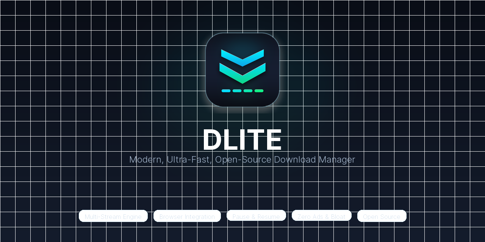
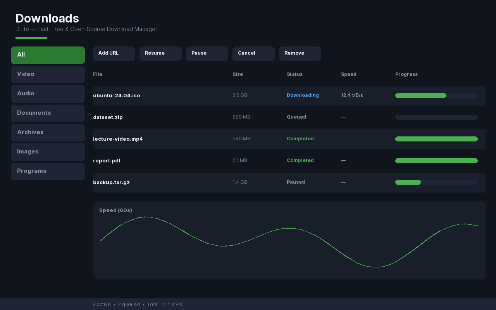
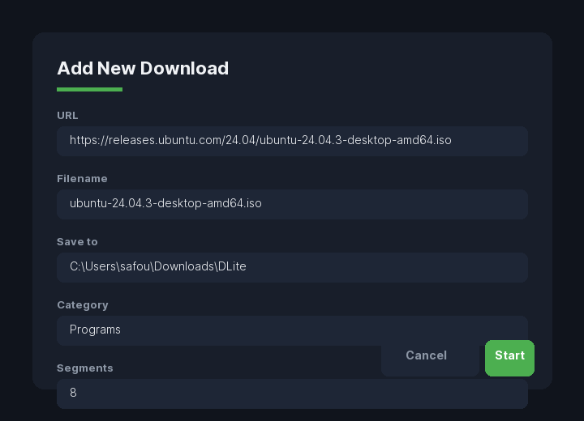
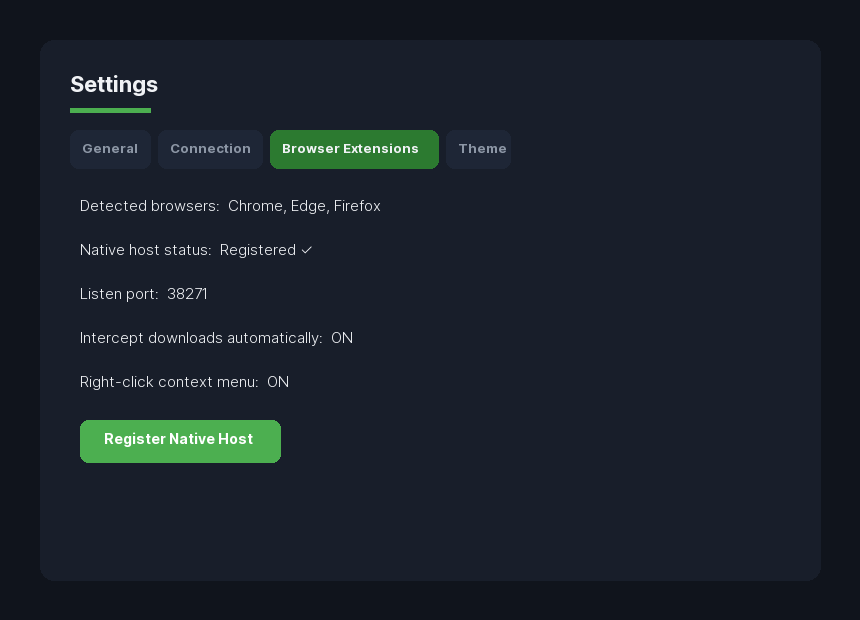
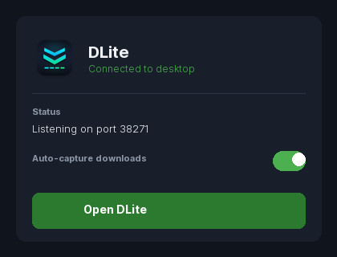
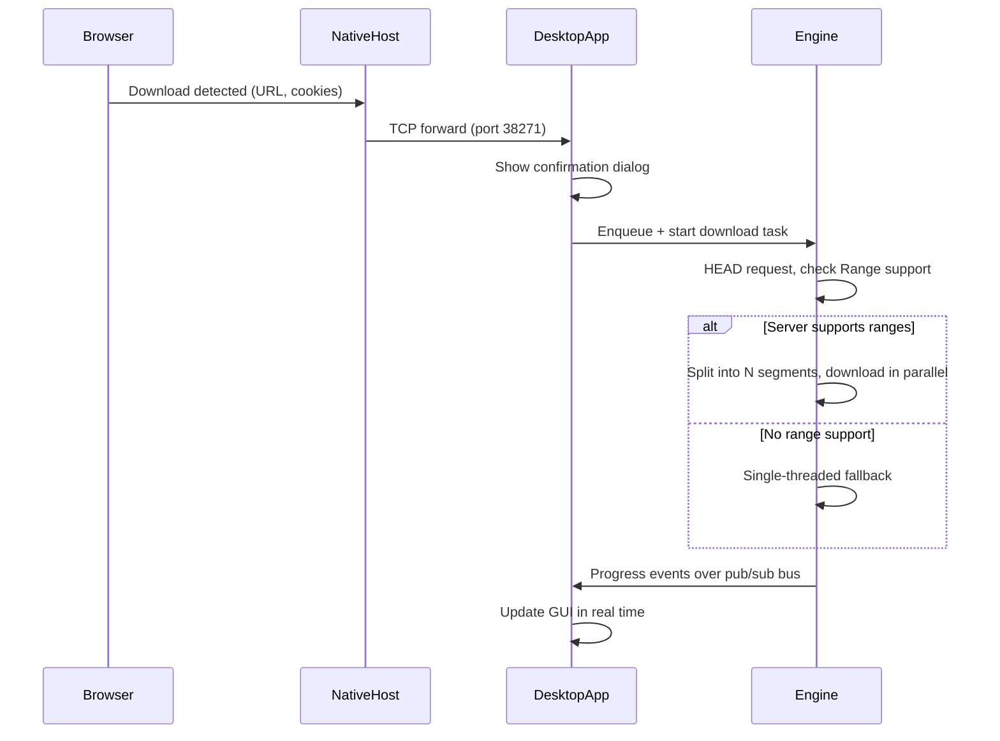

<p align="center">
  
</p>

<p align="center">
  <strong>A modern, lightweight, open-source download manager.</strong><br>
  Multi-threaded acceleration, pause/resume, browser integration, and a clean desktop UI — without the bloat.
</p>

<p align="center">
  <a href="https://github.com/test-bit-sys/DLite/releases"></a>
  <a href="LICENSE"></a>
  <a href="https://github.com/test-bit-sys/DLite/issues"></a>
  <a href="https://github.com/test-bit-sys/DLite/issues"></a>
  <a href="https://github.com/test-bit-sys/DLite/stargazers"></a>
  <a href="https://github.com/test-bit-sys/DLite/issues"></a>
  <a href="#"></a>
  <a href="#"></a>
  <a href="#"></a>
</p>

> ⚡ **DLite** is a fast, multi-threaded, open-source download accelerator and manager built with Python 3 and PyQt6. Designed as a clean, transparent, and completely free alternative to bloated proprietary tools.
>
> 🏷️ **Keywords:** `download-manager`, `download-accelerator`, `multi-threaded`, `parallel-downloads`, `pyqt6`, `python`, `open-source`, `browser-extension`, `hacktoberfest`, `good-first-issue`, `resumable-downloads`, `desktop-app`

<p align="center">
  <a href="#-installation">Installation</a> ·
  <a href="#browser-extension-setup-easy">Browser extension</a> ·
  <a href="#-usage">Usage</a> ·
  <a href="#-features">Features</a> ·
  <a href="#-architecture">Architecture</a> ·
  <a href="#-contributing">Contributing</a> ·
  <a href="CHANGELOG.md">Changelog</a>
</p>

---

## Table of Contents

- [About](#about)
- [Features](#-features)
- [Screenshots](#-screenshots)
- [Installation](#-installation)
- [Browser extension setup (easy)](#browser-extension-setup-easy)
- [Usage](#-usage)
- [Architecture](#-architecture)
- [Performance](#-performance)
- [Roadmap](#-roadmap)
- [🤝 Open Collaboration & Contributing](#-open-collaboration--contributing)
- [Issues & Bug Reports](#-issues--bug-reports)
- [Support](#-support)
- [License](#-license)

---

## About

Most download managers on the market are either abandoned, riddled with ads, or bundled with software you never asked for. **DLite** exists because downloading a file shouldn't require a toolbar, a "premium" popup, or a subscription.

It's a segmented, multi-threaded download manager built from scratch in Python, with a native browser extension that catches downloads the moment you click them — no copy-pasting URLs, no manual work.

**Why people switch to DLite:**

- **It's actually open source.** Every line of the engine, GUI, and browser extension is here. Audit it, fork it, change it.
- **It does one thing well.** No torrent client bolted on, no video converter, no built-in browser. Just fast, reliable downloading.
- **It respects your machine.** Idle memory footprint stays low, and the engine only spins up threads while a transfer is active.
- **Nothing gets lost.** The queue is written to disk after every state change, so a crash or reboot never costs you a download.

|  | DLite | Typical Download Manager |
|---|---|---|
| Segmented downloading | Up to 32 threads per file | Varies, often capped low |
| Pause / resume | Per-segment, byte-accurate | Frequently restarts from scratch |
| Queue persistence | Survives crashes and reboots | Often lost on exit |
| Browser capture | Chrome, Edge, Brave, Opera, Firefox | Usually manual paste only |
| Bundled extras | None | Toolbars, converters, ad injectors |
| License | MIT | Frequently closed-source or trialware |

---

## Features

<table>
<tr>
<td width="50%" valign="top">

**Multi-Thread Download Acceleration**
Splits files into up to 32 segments and pulls them down in parallel when the server supports HTTP range requests.

**Download Resume Support**
Every segment tracks its own offset, so an interrupted download picks up exactly where it stopped.

**Browser Integration**
A native messaging extension for Chrome, Edge, Brave, Opera, and Firefox intercepts downloads automatically. One-click installer included (see below).

**Smart File Detection**
Recognizes media, archives, and documents by content type, not just file extension. Auto-categorizes into Video, Audio, Documents, Archives, Images, and Programs.

**Pause and Resume**
Pause any active transfer instantly and resume it later without re-downloading finished segments.

**Batch URL Import & Drag-and-Drop**
Drag-and-drop URLs or `.txt` batch files directly onto DLite to queue downloads instantly.

**Cryptographic Integrity & Checksums**
Single-pass streaming MD5, SHA-1, and SHA-256 verification. Right-click any completed download or verify directly in the confirmation dialog.

</td>
<td width="50%" valign="top">

**Download Queue & Auto-Actions**
Reorder and prioritize queue items. Configurable auto-actions on completion: Exit DLite, Sleep Computer, or Shut Down with a safe countdown dialog.

**Browser Alt-Key Interception Bypass**
Hold `Alt` while clicking any download link to let your browser handle the download natively without DLite intercepting.

**Modern UI & Multi-Language (i18n)**
PyQt6 interface with dark/light themes, live 60-second speed chart, per-segment visualizer, and English / Arabic (العربية) support.

**Error Recovery & Resumability**
Failed segments retry automatically with exponential backoff before falling back to single-threaded mode.

**Lightweight Design**
No background services beyond a local native messaging host. Minimal dependencies: `requests`, `PyQt6`. No Electron, no bloat.

</td>
</tr>
</table>

---

## Screenshots

<details open>
<summary><strong>Main Window</strong></summary>
<br>
<p align="center">
  
</p>
<p align="center"><em>Categories sidebar, real-time speed graph, segment progress visualizer, and per-download progress in one view.</em></p>
</details>

<details>
<summary><strong>Download Confirmation Dialog</strong></summary>
<br>
<p align="center">
  
</p>
<p align="center"><em>Review filename, save location, category, segment count, and speed limit before starting.</em></p>
</details>

<details>
<summary><strong>Settings Window</strong></summary>
<br>
<p align="center">
  
</p>
<p align="center"><em>Control downloads, connection parameters, browser extensions, and theme from tabbed settings.</em></p>
</details>

<details>
<summary><strong>Browser Extension Integration</strong></summary>
<br>
<p align="center">
  
</p>
<p align="center"><em>Click any download link and DLite captures it automatically.</em></p>
</details>

---

## Installation

### Option A — Windows installer (recommended, easiest)

1. Download **`DLite-Setup.exe`** from the
   [latest release](https://github.com/test-bit-sys/DLite/releases/latest).
2. Run it — no admin rights required, and **no Python needed**. The installer
   contains the app, the browser extensions, and the native messaging host.
3. After installing, open **Start Menu → DLite → Setup Browser Extension**
   to connect your browser in one click (see
   [Browser extension setup](#browser-extension-setup-easy) below).

> SHA-256 checksums are published with every release. Verify the checksum
> before installing if you downloaded the file from a mirror.

### Option B — Run from source (developers)

Requirements: Windows 10/11, Python 3.10+, `pip`.

```bash
git clone https://github.com/test-bit-sys/DLite.git
cd DLite
pip install -r requirements.txt
python main.py
```

### Option C — Build your own installer / portable exe

The `installer/` folder contains a complete build pipeline (PyInstaller +
Inno Setup). See **[installer/README.md](installer/README.md)** for details.

Quick start (Windows, from the repo root):

```bat
installer\build_installer.bat
```

This produces `dist\DLite-Setup.exe` (installer) and a portable
`dist\DLite\DLite.exe`.

For a one-file portable build only:

```bash
pip install pyinstaller
pyinstaller --onefile --windowed --name DLite main.py
```

The compiled binary will be in `dist/DLite.exe`.

### Dependencies

| Package | Purpose |
|---|---|
| `requests` | HTTP client for the download engine |
| `PyQt6` | Desktop GUI framework |
| `Pillow` | Icon generation (optional, only needed to regenerate extension icons) |

---

## Browser extension setup (easy)

DLite can intercept downloads from **Chrome, Edge, Brave, Opera, and Firefox**
automatically. Setup takes about 30 seconds.

**Easiest way (after installing via the installer):**

Open **Start Menu → DLite → Setup Browser Extension**. This one-click helper:

1. Registers the native messaging host for all supported browsers.
2. Opens the correct `chrome://extensions` / `about:debugging` page in each
   detected browser so you just have to click **Load unpacked** (or
   **Load Temporary Add-on** for Firefox) and pick the bundled
   `browser-extension/` folder.

**From source:**

```bash
python installer/install_browser_extensions.py            # detect & set up all browsers
python installer/install_browser_extensions.py --browser chrome
python installer/install_browser_extensions.py --browser firefox
python installer/install_browser_extensions.py --browser edge
```

**From inside the app:** Open **Settings → Browser Extensions** tab → click
**Install Native Host** for each detected browser, then load the unpacked
extension as described below.

**Manual fallback:**

```bash
python native_host/install_host.py
```

Then load the unpacked extension:

- **Chrome / Edge / Brave / Opera** — open `chrome://extensions`, enable
  **Developer mode**, click **Load unpacked**, select `browser-extension/chromium/`.
- **Firefox** — open `about:debugging#/runtime/this-firefox`, click
  **Load Temporary Add-on**, select `browser-extension/firefox/manifest.json`.

For a permanent Firefox install, replace the placeholder extension ID in
`native_host/install_host.py` with your signed extension's real ID.

---

## Usage

### Downloading a file

1. Launch the app (`python main.py`, or the installed `DLite.exe`).
2. Click **Add URL** (or press Ctrl+N), paste the URL.
3. Review the confirmation dialog — set filename, save location, category, segments, and speed limit.
4. Click **Start** to begin downloading.

### Using the browser extension

Once the native host is installed and the app is running, downloads triggered from a supported browser are intercepted automatically. The confirmation dialog opens in-app so you can review before starting. Right-click any link or media and choose **Download with DLite** to capture it manually.

### Managing the queue

- Select one or more rows, right-click for pause, resume, cancel, open folder, open file, remove, or delete with file.
- Use Downloads menu or keyboard shortcuts for bulk actions: Pause All (Ctrl+Shift+P), Resume All (Ctrl+Shift+R), Clear Completed (Ctrl+Shift+D).
- Set `max_concurrent_downloads` in Settings to control how many downloads run at once.
- Search/filter the table with the search box in the toolbar.

### Configuring settings

Settings live in `%APPDATA%\DLite\config.json` on Windows (`~/.config/DLite/config.json` for development on Linux/macOS).

| Setting | Default | Description |
|---|---|---|
| `download_dir` | `~/Downloads/DLite` | Where completed files are saved |
| `max_concurrent_downloads` | `3` | Maximum simultaneous downloads |
| `max_segments` | `8` | Threads per individual download |
| `speed_limit_kbps` | `0` | Global speed limit (0 = unlimited) |
| `retry_attempts` | `5` | Retry attempts per failed segment |
| `retry_delay_seconds` | `3` | Delay before retrying a failed segment |
| `chunk_size` | `262144` | Read/write chunk size in bytes |
| `native_host_port` | `38271` | Local TCP port for browser integration |
| `theme` | `dark` | `dark` or `light` |
| `user_agent` | `""` | Custom HTTP User-Agent header |

---

## Architecture

```
dlite/
├── engine/                 Download engine (zero Qt imports)
│   ├── downloader.py       Multi-segment parallel downloader with bandwidth throttling
│   ├── queue_manager.py    Persistent queue, concurrency gating, deduplication
│   ├── config.py           JSON-backed settings with atomic writes
│   ├── models.py           Data classes: DownloadTask, Segment, DownloadStatus
│   ├── events.py           Thread-safe pub/sub event bus
│   └── logger.py           Structured logging with rotating file handler
│
├── gui/                    PyQt6 desktop interface (zero networking code)
│   ├── main_window.py      Toolbar, category sidebar, downloads table, system tray
│   ├── add_download_dialog.py URL entry + download confirmation dialog
│   ├── settings_dialog.py  Tabbed settings: general, connection, browser extensions
│   └── theme.py            Dark and light theme QSS stylesheets
│
├── native_host/            Browser-to-desktop bridge
│   ├── host.py             JSON over stdin/stdout native messaging host
│   ├── host.bat            Windows batch launcher for the Python host
│   └── install_host.py     Registry installer for native messaging manifests
│
├── installer/              Build pipeline + one-click browser extension installer
│   ├── DLite.spec        PyInstaller spec (onedir bundle)
│   ├── DLite-Setup.iss  Inno Setup script (polished installer)
│   ├── build_installer.bat One-click build: PyInstaller + Inno Setup
│   └── install_browser_extensions.py  One-click browser extension setup
│
├── browser-extension/
│   ├── chromium/           Manifest V3 (Chrome, Edge, Brave, Opera)
│   └── firefox/            Manifest V2 (Firefox WebExtensions)
│
├── website/                Next.js 14 official landing page
│   └── src/                TypeScript + Tailwind CSS, dark/light mode support
│
├── icons/                  PNG, ICO, ICNS icon variants (16 → 1024 px)
├── docs/                   Screenshots and GitHub social preview assets
├── tests/                  Unit and integration tests
├── main.py                 Entry point: IPC listener + GUI launch
├── CHANGELOG.md            Release history (Keep a Changelog format)
├── CONTRIBUTING.md         Contribution guide with coding standards
├── LICENSE                 MIT License
└── requirements.txt
```

**Frontend** — PyQt6 handles all rendering. It has zero networking code and only reacts to events published by the engine.

**Backend / Download Engine** — Pure Python, no Qt imports. Issues a `HEAD` request to check for `Range` support, splits eligible files into up to 32 segments, and writes each one directly to its offset in a pre-allocated sparse file. Failed segments retry with exponential backoff before the engine falls back to single-threaded mode. A token-bucket rate limiter enforces the global speed limit.

**Browser Extension** — `background.js` listens for `downloads.onCreated` and forwards the URL and cookies to the native host. `content.js` handles in-page media and link capture for right-click download context menu items.

**Native Host** — A stateless bridge (`host.py`) that forwards JSON messages from the browser over a loopback TCP socket to the desktop app. It holds no state of its own.

**Database** — No external database. The queue and history are persisted as JSON under the app data directory, keeping the dependency list short and the install simple.



---

## Performance

- **Speed** — Segmenting a file across multiple TCP connections routinely saturates available bandwidth on servers that throttle per-connection speed, which single-threaded clients can't do.
- **Multi-threading** — Segment count is configurable (default 8, max 32). More segments help on high-latency links; fewer segments avoid needless overhead on small files or fast local networks.
- **Memory** — Segments are written directly to disk at their target offset instead of buffering in RAM, so memory use stays flat regardless of file size.
- **CPU** — The engine is I/O-bound rather than CPU-bound; idle CPU usage is close to zero between polling intervals.

Actual throughput depends on your connection, the target server's per-connection limits, and disk write speed — segmenting won't help against a server that already caps total bandwidth regardless of connection count.

---

## Roadmap

**Shipped in v1.0.0**

- [x] Segmented multi-threaded downloading (up to 32 segments) with automatic fallback
- [x] Persistent, crash-safe queue with auto-promotion
- [x] Browser extension integration for Chrome, Edge, Brave, Opera, and Firefox
- [x] One-click installer (Inno Setup) + one-click browser extension setup
- [x] Dark and light themes, live 60-second speed graph, segment progress visualizer
- [x] Category sidebar with auto-categorization by file extension
- [x] Pre-download confirmation dialog with configurable segments and speed limit
- [x] System tray with minimize-to-tray behavior
- [x] Batch URL import from text files
- [x] Download deduplication and duplicate filename handling
- [x] Configurable retry with exponential backoff
- [x] Terminal-styled in-app log viewer
- [x] Context menus, bulk operations, keyboard shortcuts

**Shipped in v1.1.0**

- [x] Built-in streaming cryptographic checksum verification (MD5, SHA-1, SHA-256)
- [x] Download scheduler with time-based throttling windows and overnight support
- [x] Clipboard URL monitoring and auto-capture for downloadable media, files, and archives
- [x] Batch URL pattern generator (`[01-20]`, `[1-50:2]`, `[a-z]`) with Cartesian expansion
- [x] Native desktop system tray completion notifications
- [x] Safe auto-actions on completion (Shut down, Sleep, Exit) with countdown dialog

**Future exploration**

- [ ] macOS and Linux native builds
- [ ] Mirror/multi-source downloading for the same file
- [ ] Torrent and magnet link support
- [ ] Plugin API for community extensions

Have an idea that's not listed? Open an issue — the roadmap is shaped by what people actually ask for.

---

## 🤝 Open Collaboration & Contributing

> **🌟 We are actively welcoming fellow developers, designers, and enthusiasts to collaborate on DLite!**
> Whether you want to add a feature, improve performance, port to Linux/macOS, or polish the UI, your contributions and ideas are warmly invited.

### 💡 Where We Need Your Help:
We are building a community-driven, truly modern download ecosystem. Here are key areas open for collaboration:

- **🐧 Cross-Platform Packaging:** Porting and packaging DLite for Linux (`.deb`, `AppImage`, `Flatpak`) and macOS (`.dmg`, `Homebrew`).
- **🌐 Browser Extensions:** Adding support for Safari, enhancing WebExtensions capabilities, and preparing listings for the Chrome Web Store & Firefox Add-ons.
- **⚡ Advanced Engine Capabilities:**
  - BitTorrent protocol support & magnet link handling.
  - Automatic cryptographic checksum verification (`SHA-256`, `MD5`, `SHA-1`).
  - Bandwidth scheduling & speed limiter presets.
- **🎨 UI & Customization:**
  - Modern animations, compact view mode, and custom theme presets.
  - Multi-language localization / i18n (Arabic, French, Spanish, German, Chinese, etc.).
- **🧪 Testing & CI:** Expanded integration test coverage and automated build pipelines.

### 🚀 How to Get Started:
1. **Explore the Codebase:** Check out our modular architecture in [`engine/`](engine/) and [`gui/`](gui/).
2. **Find an Issue:** Look through our [Issue Tracker](https://github.com/test-bit-sys/DLite/issues) for issues tagged with `good first issue` or `help wanted`.
3. **Propose New Ideas:** Have a great idea or feature? Open a [Discussion](https://github.com/test-bit-sys/DLite/discussions) or a [Feature Request](https://github.com/test-bit-sys/DLite/issues/new?template=feature_request.md).
4. **Submit a PR:** Fork the repository, create your feature branch, test your changes (`python -m pytest`), and open a Pull Request. We review and merge PRs quickly!

See **[CONTRIBUTING.md](CONTRIBUTING.md)** for our complete code style guide, development setup, and PR conventions.

---

## Issues & Bug Reports

Found something broken or have a feature request? [Open an issue](https://github.com/test-bit-sys/DLite/issues) and include:

- What you expected vs. what happened
- Steps to reproduce
- Your OS version and Python version
- Relevant log output from `%APPDATA%\DLite\dlite.log`

Use the **Bug Report** or **Feature Request** templates when creating a new issue. Duplicate issues are merged, not closed.

---

## Support

- **Documentation** — this README, [installer/README.md](installer/README.md), [CONTRIBUTING.md](CONTRIBUTING.md), and [CHANGELOG.md](CHANGELOG.md) cover installation, configuration, architecture, and release history.
- **Community** — use [GitHub Discussions](https://github.com/test-bit-sys/DLite/discussions) for questions, ideas, and general conversation.
- **Contact** — **Safouane Baadoud** — <a href="mailto:safouaneescrow@gmail.com">safouaneescrow@gmail.com</a>, or reach the maintainer through [GitHub](https://github.com/safouaneescrow-cyber) / by opening an issue.

---

## License

Released under the **MIT License** — use it, modify it, ship it, sell it. See [LICENSE](LICENSE) for the full text.

---

<p align="center">
  Maintained by <strong>Safouane Baadoud</strong> — <a href="mailto:safouaneescrow@gmail.com">safouaneescrow@gmail.com</a>
</p>

<p align="center">
  If DLite is useful to you, consider starring the repo, forking it, or sending a pull request.<br>
  Every contribution, big or small, keeps it alive.
</p>